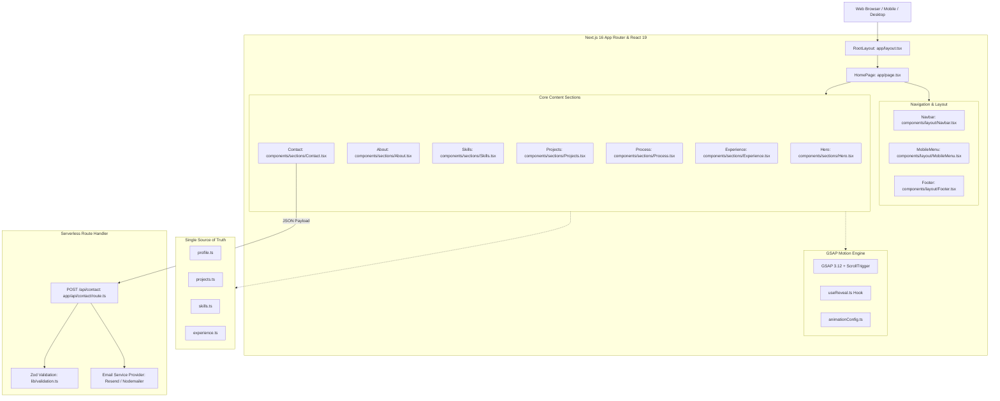
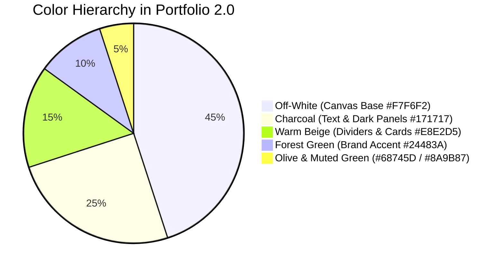
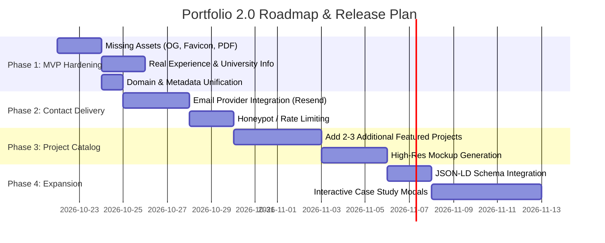

# Product Requirements Document (PRD): Ashish Sahu Portfolio 2.0

**Document Version:** 1.0.0  
**Project Name:** `ashish-portfolio` (Portfolio 2.0)  
**Author:** Pair Programming Assistant & Ashish Sahu  
**Status:** Living Document / Active Development  
**Target Deployment URL:** [https://iamashish.vercel.app](https://iamashish.vercel.app) (or [https://ashishsahu.dev](https://ashishsahu.dev))  
**Repository Location:** [next_Portfolio_2.0](file:///d:/next_Portfolio_2.0)

---

## 1. Executive Summary & Product Vision

### 1.1 Vision Statement

Ashish Sahu's Portfolio 2.0 is an editorial, high-performance web portfolio engineered to position Ashish as a top-tier Full Stack Developer (graduating batch of 2026). Moving away from generic developer templates, the application adopts an **"editorial craft meets engineering precision"** design aesthetic, combining warm organic tones (forest greens, warm beige, charcoal), bespoke typography, rich interactive micro-animations (powered by GSAP 3.12), and robust web architecture built on Next.js 16 and React 19.

### 1.2 Target Audience & Personas

1. **Technical Recruiters & Talent Scouts:** Needs immediate clarity on role, graduation year (2026), core tech stack (React, Next.js, Node.js, MongoDB), location, and quick access to a 1-click resume download and LinkedIn.
2. **Engineering Managers & Tech Leads:** Looks beyond superficial styling to inspect architectural rigor, code hygiene, animation performance, accessibility, project depth, problem-solving narrative, and Git commit discipline.
3. **Freelance Clients / Collaborators:** Seeks evidence of end-to-end execution capability (from UI design and REST API architecture to database schemas and production deployment).

### 1.3 Key Value Propositions

- **High-Impact Visual Identity:** Editorial magazine-grade typography pairing [Playfair Display](file:///d:/next_Portfolio_2.0/app/layout.tsx#L12-L16) and [Inter](file:///d:/next_Portfolio_2.0/app/layout.tsx#L6-L10) with handwritten personal touches ([Caveat](file:///d:/next_Portfolio_2.0/app/layout.tsx#L25-L30)) and developer monospacing ([JetBrains Mono](file:///d:/next_Portfolio_2.0/app/layout.tsx#L18-L23)).
- **Single Source of Truth (SSOT):** Decoupled content management via strongly typed TypeScript data files in [data/](file:///d:/next_Portfolio_2.0/data), allowing updates to projects, bio, skills, and experience without altering UI component JSX.
- **Fluid Motion & Engineering Micro-interactions:** GPU-accelerated GSAP timelines with ScrollTrigger, reduced-motion fallbacks, ambient floating cards, and responsive interactive states.
- **Production-Grade Reliability:** Next.js App Router, strict TypeScript type-checking, Zod runtime schema validation, and serverless API endpoints.

---

## 2. Architecture & Technology Stack

### 2.1 System Architecture Diagram



### 2.2 Technology Stack Summary

| Layer                | Technology                 | Version           | Purpose / Rationale                                                                                                                 |
| :------------------- | :------------------------- | :---------------- | :---------------------------------------------------------------------------------------------------------------------------------- |
| **Framework**        | Next.js (App Router)       | `16.4.0`          | React Server Components, file-based routing, SEO optimization, and serverless API routes                                            |
| **UI Library**       | React & React DOM          | `19.0.0`          | Latest concurrent rendering engine and hooks                                                                                        |
| **Language**         | TypeScript                 | `^5.x`            | End-to-end static typing and interface enforcement                                                                                  |
| **Styling**          | Tailwind CSS & Vanilla CSS | `^3.4.1`          | Utility-first responsive design combined with bespoke design tokens in [globals.css](file:///d:/next_Portfolio_2.0/app/globals.css) |
| **Animation Engine** | GSAP & `@gsap/react`       | `^3.12.5`         | High-fidelity scroll animations, timeline sequencing, and ambient micro-interactions                                                |
| **Iconography**      | Lucide React               | `^0.462.0`        | Clean, consistent SVG icons                                                                                                         |
| **Form Handling**    | React Hook Form & Zod      | `^7.53` / `^3.23` | High-performance, schema-driven form validation and type inference                                                                  |
| **Class Utilities**  | `clsx` & `tailwind-merge`  | `^2.1` / `^2.5`   | Dynamic Tailwind class composition helper [cn](file:///d:/next_Portfolio_2.0/lib/utils.ts#L4-L6)                                    |

---

## 3. Detailed Component & Section Specifications

### 3.1 Global Navigation

- **Files:** [Navbar.tsx](file:///d:/next_Portfolio_2.0/components/layout/Navbar.tsx), [MobileMenu.tsx](file:///d:/next_Portfolio_2.0/components/layout/MobileMenu.tsx)
- **Functionality:**
  - Fixed positioning (`z-50`) with dynamic scroll listener (`scrolled > 40px`) toggling frosted glass background (`bg-off-white/95 backdrop-blur-sm shadow-sm`).
  - ScrollSpy powered by `IntersectionObserver` across `#about`, `#skills`, `#projects`, `#experience`, and `#contact` to highlight active links.
  - Wordmark with 1-click smooth scroll to top.
  - Direct resume download action CTA button in the header.
  - Accessible full-screen mobile drawer with GSAP stagger animation and body scroll locking (`overflow: hidden`).

### 3.2 Hero Section ([Hero.tsx](file:///d:/next_Portfolio_2.0/components/sections/Hero.tsx))

- **Visual Style:** Editorial magazine composition with technical blueprint aesthetics.
- **Key Elements:**
  1. **Background Engineering Grid:** Subtle SVG blueprint coordinate pattern (`#DDD7CB`), dot matrix clusters, and dual-ambient sage green atmospheric glow blobs.
  2. **Status Pill:** Live green pulsing dot with `"Available for work / Full Stack Developer"`.
  3. **Editorial Heading:** Split typography displaying `"Ashish"` in bold Playfair Display serif and `"Sahu"` in italic Playfair serif.
  4. **Subheading Bar:** Monospaced bold label `"FULL STACK DEVELOPER"` with an accent horizontal rule.
  5. **Bio Paragraph:** Crisp, punchy intro highlighting React, Next.js, Node.js, and MongoDB.
  6. **Metadata Chips:** Badges for `"Graduating 2026"` and `"India"`.
  7. **Dual Action CTAs:** Primary rounded pill `"View My Work"` (smooth scrolls to `#projects`) and secondary outline pill `"Download Resume"` (links to `/resume/ashish-sahu-resume.pdf`).
  8. **Social Links Row:** GitHub, LinkedIn, and Mail links with subtle hover transitions.
  9. **Key Metrics Bar:** 3-column stats counters (`20+ Projects Built`, `3+ Technologies`, `1+ Years of Learning`).
  10. **Visual Right Column:**
      - Organic circular backdrop in sage green (`#8A9B87`) with dashed orbital sweep lines.
      - Ashish Sahu transparent cutout portrait (`/images/ashish-editorial.png`) with drop shadow and fallback monogram avatar.
      - Vertical floating stack of 4 tech icon cards (React, Next.js, Node.js, MongoDB) with staggered sine-wave floating animations.
      - Floating dark window code card (`developer.ts`) featuring syntax-highlighted object structure.
      - Hand-drawn arrow doodles and handwritten annotations in [Caveat](file:///d:/next_Portfolio_2.0/app/layout.tsx#L25-L30) font (`"Turning Ideas into Real Products"`, `"Always Learning, Always Building"`).
      - Floating badge card for `"Clean Code / Better Products"`.

### 3.3 About Section ([About.tsx](file:///d:/next_Portfolio_2.0/components/sections/About.tsx))

- **Layout:** Asymmetric 2-column grid (`lg:grid-cols-12`, 7 cols story vs 5 cols focus areas).
- **Story Narrative:** Introduces Ashish as a Computer Science and Engineering student and aspiring Full Stack Developer, detailing full-stack web proficiency, DSA in Java, and architectural mindset.
- **Focus Areas List:** Structured rows with icon containers:
  - Frontend Development (React, Next.js, responsive UI)
  - Backend Engineering (Node.js, Express.js, REST APIs)
  - Database Design (MongoDB, MySQL, data modeling)
  - Algorithms & Architecture (Java, DSA, maintainable code)
  - Developer Tooling (Git, GitHub, Postman, debugging)

### 3.4 Technical Skills Section ([Skills.tsx](file:///d:/next_Portfolio_2.0/components/sections/Skills.tsx))

- **Layout:** Full-width editorial grid with dividing borders on warm beige backdrop.
- **Taxonomy:** 4 distinct categories configured in [skills.ts](file:///d:/next_Portfolio_2.0/data/skills.ts):
  - **Frontend:** HTML5, CSS3, JavaScript, React, Next.js, Tailwind CSS
  - **Backend:** Node.js, Express.js, REST APIs, JWT Authentication
  - **Databases:** MongoDB, MongoDB Atlas, MySQL
  - **Tools & Languages:** Java, Data Structures & Algorithms, Git, GitHub, VS Code, Postman
- **Interactive Behavior:** Hover micro-transitions on skill tags (`border-color`, `forest` accent, background tint).
- **Integrity Notice:** Transparent note acknowledging honest skill representation over arbitrary percentage bars.

### 3.5 Selected Projects Section ([Projects.tsx](file:///d:/next_Portfolio_2.0/components/sections/Projects.tsx))

- **Layout:** Alternating two-column editorial showcase (odd/even alternating image and description).
- **Card Details:**
  - Numbered index label (`01`, `02`, etc.)
  - Year and category badges (`2024` · `Full Stack Application`)
  - Project title in serif typography
  - Comprehensive project narrative (`longDescription`)
  - Feature checklist with green checkmarks ([CheckCircle2](file:///d:/next_Portfolio_2.0/components/sections/Projects.tsx#L7))
  - Tech stack tag pills
  - Live Demo link ([ExternalLink](file:///d:/next_Portfolio_2.0/components/sections/Projects.tsx#L7)) and Source Code link ([Github](file:///d:/next_Portfolio_2.0/components/sections/Projects.tsx#L7))
- **Initial Project Seed:** MERN Learning Management System (LMS) with JWT authentication, RBAC, quizzes, course administration, and attendance tracking.

### 3.6 Development Process Section ([Process.tsx](file:///d:/next_Portfolio_2.0/components/sections/Process.tsx))

- **Theme:** High-contrast dark section (`bg-charcoal text-off-white`).
- **5-Step Workflow:**
  1. **Discover:** Requirements analysis and problem framing.
  2. **Design:** Interface wireframing, architecture, and data modeling.
  3. **Develop:** Modular, clean, type-safe implementation.
  4. **Integrate:** API connectivity, database persistence, and auth.
  5. **Test & Deploy:** Cross-device validation, optimization, and production release.
- **Animations:** Horizontal connecting progress line (`scaleX` GSAP timeline) on desktop, transitioning to a vertical milestone track on mobile.

### 3.7 Background & Experience Section ([Experience.tsx](file:///d:/next_Portfolio_2.0/components/sections/Experience.tsx))

- **Layout:** Clean resume-style chronological feed.
- **Supported Types:** `education`, `internship`, `project`, `certification` with distinct Lucide icons ([GraduationCap](file:///d:/next_Portfolio_2.0/components/sections/Experience.tsx#L7), [Briefcase](file:///d:/next_Portfolio_2.0/components/sections/Experience.tsx#L7), [FolderOpen](file:///d:/next_Portfolio_2.0/components/sections/Experience.tsx#L7), [Award](file:///d:/next_Portfolio_2.0/components/sections/Experience.tsx#L7)).
- **Content:** Organization, timeline period, description, and coursework/achievement badges.

### 3.8 Contact & Lead Generation ([Contact.tsx](file:///d:/next_Portfolio_2.0/components/sections/Contact.tsx), [route.ts](file:///d:/next_Portfolio_2.0/app/api/contact/route.ts))

- **Left Column:** Direct contact links (Email, GitHub, LinkedIn, Resume PDF download).
- **Right Column:** Reactive form powered by React Hook Form & Zod schema validation:
  - Fields: `name` (2-60 chars), `email` (valid email format), `subject` (4-100 chars), `message` (20-2000 chars).
  - States: `idle`, `submitting` (spinner button), `success` (confirmation screen with "Send another" trigger), and `error` (contextual banner).
- **API Handler:** Serverless endpoint [app/api/contact/route.ts](file:///d:/next_Portfolio_2.0/app/api/contact/route.ts) with JSON validation and 400/500 structured status responses.

### 3.9 Footer ([Footer.tsx](file:///d:/next_Portfolio_2.0/components/layout/Footer.tsx))

- **Theme:** Dark charcoal background with subtle neutral typography.
- **Elements:** Wordmark, title, social icons, dynamic copyright year (`new Date().getFullYear()`), and a smooth [BackToTop](file:///d:/next_Portfolio_2.0/components/ui/BackToTop.tsx) trigger.

---

## 4. Design System & Style Guide

### 4.1 Color Palette Tokens



| Token Name              | Hex Code  | Semantic Role                                                              |
| :---------------------- | :-------- | :------------------------------------------------------------------------- |
| `--color-off-white`     | `#F7F6F2` | Primary page canvas, card backgrounds, light contrast                      |
| `--color-charcoal`      | `#171717` | High-contrast body text, primary button backgrounds, dark mode blocks      |
| `--color-forest`        | `#24483A` | Primary editorial green accent, hover states, active indicators, selection |
| `--color-olive`         | `#68745D` | Secondary accent, italics, subtle border highlights, scrollbar thumb       |
| `--color-beige`         | `#E8E2D5` | Neutral surfaces, horizontal rules, skill section background, card borders |
| `--color-neutral-mid`   | `#8A8A8A` | Secondary supporting descriptions, helper labels, disabled states          |
| `--color-neutral-light` | `#C8C4BB` | Subtle borders and divider lines                                           |
| `--color-neutral-dark`  | `#3A3A3A` | Deep charcoal secondary text                                               |

### 4.2 Typography System

| Font Variable           | Font Family                        | Usage                                                            |
| :---------------------- | :--------------------------------- | :--------------------------------------------------------------- |
| `var(--font-inter)`     | **Inter** (Google Font)            | UI elements, body copy, form inputs, button labels, and metadata |
| `var(--font-playfair)`  | **Playfair Display** (Google Font) | Editorial section titles, hero name, quotes, serif accents       |
| `var(--font-jetbrains)` | **JetBrains Mono** (Google Font)   | Code snippets, status labels, tags, numbered steps, dates        |
| `var(--font-caveat)`    | **Caveat** (Google Font)           | Hand-drawn personal annotations, notes, and doodle text          |

### 4.3 Motion Principles & Accessibility

- **Tooling:** GSAP 3.12 with ScrollTrigger plugin.
- **Easing:** `power2.out` for reveals, `back.out(1.2)` for floating card pop-ins, `sine.inOut` for continuous ambient floating.
- **Accessibility (a11y):** All animations query `window.matchMedia('(prefers-reduced-motion: reduce)')`. When reduced motion is preferred, animations complete immediately with zero delay, opacity `1`, and transforms `0`.

---

## 5. Data Architecture & Schemas

The application enforces strong typing using TypeScript interfaces across all data collections:

### 5.1 Profile Schema ([profile.ts](file:///d:/next_Portfolio_2.0/data/profile.ts))

```typescript
interface Profile {
  name: string;
  firstName: string;
  lastName: string;
  title: string;
  graduatingYear: string;
  profileImage: string;
  headline: string;
  subheadline: string;
  heroIntroduction: string;
  statusPhrase: string;
  location: string;
  locationShort: string;
  opportunityStatus: string;
  available: boolean;
  email: string;
  github: string;
  linkedin: string;
  resumeUrl: string;
  heroTechStack: string[];
  cta: { work: string; resume: string };
  stats: Array<{ value: string; label: string }>;
  about: {
    title: string;
    headline: string;
    intro: string;
    extended: string;
    philosophy: string;
    focus: string[];
  };
}
```

### 5.2 Project Schema ([projects.ts](file:///d:/next_Portfolio_2.0/data/projects.ts))

```typescript
export interface Project {
  id: string;
  title: string;
  category: string;
  description: string;
  longDescription: string;
  features: string[];
  stack: string[];
  liveUrl?: string;
  githubUrl?: string;
  image: string;
  featured: boolean;
  year: string;
}
```

### 5.3 Experience Schema ([experience.ts](file:///d:/next_Portfolio_2.0/data/experience.ts))

```typescript
export interface ExperienceItem {
  id: string;
  type: "education" | "internship" | "project" | "certification";
  title: string;
  organization: string;
  period: string;
  description: string;
  highlights?: string[];
}
```

### 5.4 Contact Validation Schema ([lib/validation.ts](file:///d:/next_Portfolio_2.0/lib/validation.ts))

```typescript
export const contactSchema = z.object({
  name: z.string().min(2, "Name must be at least 2 characters").max(60),
  email: z.string().email("Please enter a valid email address"),
  subject: z.string().min(4, "Subject must be at least 4 characters").max(100),
  message: z
    .string()
    .min(20, "Message must be at least 20 characters")
    .max(2000),
});
```

---

## 6. Audit Findings & Gap Analysis

A comprehensive audit of the active codebase revealed the following critical gaps, missing assets, and inconsistencies that must be addressed:

| Item #   | Area                         | Issue Description                                                                                                                                                                                                                                                                      | File Location                               | Severity   |
| :------- | :--------------------------- | :------------------------------------------------------------------------------------------------------------------------------------------------------------------------------------------------------------------------------------------------------------------------------------- | :------------------------------------------ | :--------- |
| **G-01** | **Asset Availability**       | `og-image.jpg` is declared in [layout.tsx](file:///d:/next_Portfolio_2.0/app/layout.tsx#L59) for OpenGraph and Twitter cards, but the file is missing from `/public/`.                                                                                                                 | `public/og-image.jpg`                       | **High**   |
| **G-02** | **Asset Availability**       | `favicon.ico` is referenced in [layout.tsx](file:///d:/next_Portfolio_2.0/app/layout.tsx#L93), but only `icon.svg` is present in `/public/`.                                                                                                                                           | `public/favicon.ico`                        | **Medium** |
| **G-03** | **Project Visuals**          | `lms-preview.jpg` is missing from `/public/projects/`; `Projects.tsx` currently renders a fallback placeholder card with commented out `next/image`.                                                                                                                                   | `public/projects/lms-preview.jpg`           | **High**   |
| **G-04** | **Resume Document**          | The resume download buttons link to `/resume/ashish-sahu-resume.pdf`, which does not yet exist.                                                                                                                                                                                        | `public/resume/ashish-sahu-resume.pdf`      | **High**   |
| **G-05** | **Domain Inconsistency**     | Domain mismatch between [layout.tsx](file:///d:/next_Portfolio_2.0/app/layout.tsx#L33) (`ashishsahu.dev`), [robots.ts](file:///d:/next_Portfolio_2.0/app/robots.ts#L9) (`ashishsahu.dev`), and [sitemap.ts](file:///d:/next_Portfolio_2.0/app/sitemap.ts#L6) (`iamashish.vercel.app`). | `app/layout.tsx`, `robots.ts`, `sitemap.ts` | **Medium** |
| **G-06** | **Experience Content**       | [data/experience.ts](file:///d:/next_Portfolio_2.0/data/experience.ts#L16-L20) contains placeholder strings (`"Your University Name"`, `"Add your actual years here"`).                                                                                                                | `data/experience.ts`                        | **Medium** |
| **G-07** | **Contact API Delivery**     | [app/api/contact/route.ts](file:///d:/next_Portfolio_2.0/app/api/contact/route.ts#L31-L34) logs to `console.log` but does not send an actual email via an email provider (e.g. Resend / Nodemailer).                                                                                   | `app/api/contact/route.ts`                  | **Medium** |
| **G-08** | **Project Catalog Depth**    | [data/projects.ts](file:///d:/next_Portfolio_2.0/data/projects.ts) contains only 1 project (LMS). A competitive portfolio requires at least 3-4 diverse projects.                                                                                                                      | `data/projects.ts`                          | **Medium** |
| **G-09** | **Live Demo / Repo Links**   | In [data/projects.ts](file:///d:/next_Portfolio_2.0/data/projects.ts#L37-L38), `liveUrl` and `githubUrl` are commented out, resulting in "Demo not yet deployed" in the UI.                                                                                                            | `data/projects.ts`                          | **Low**    |
| **G-10** | **Design Token Unification** | Some UI components ([Button.tsx](file:///d:/next_Portfolio_2.0/components/ui/Button.tsx), [SectionHeading.tsx](file:///d:/next_Portfolio_2.0/components/ui/SectionHeading.tsx)) are unused because sections implement bespoke heading and button layouts.                              | `components/ui/`                            | **Low**    |

---

## 7. Functional & Non-Functional Requirements

### 7.1 Functional Requirements (FR)

#### FR-1: Hero & Identity

- **FR-1.1:** Must dynamically render profile data from [profile.ts](file:///d:/next_Portfolio_2.0/data/profile.ts) (name, title, graduation batch, stats, social URLs).
- **FR-1.2:** Must provide a 1-click download trigger for the resume PDF.
- **FR-1.3:** Must support an image error fallback displaying a stylized monogram avatar if the portrait fails to load.

#### FR-2: Projects Showcase

- **FR-2.1:** Must support filtering or displaying featured projects with tags, category, screenshots, feature bullets, and tech stack.
- **FR-2.2:** Must conditionally render live demo and GitHub repository buttons only when URLs are provided.

#### FR-3: Skills & Experience Taxonomy

- **FR-3.1:** Must render categorized skill groups with hover micro-interactions.
- **FR-3.2:** Must format educational degrees, internships, and certifications with type-specific badges and timeframes.

#### FR-4: Contact & Inquiries

- **FR-4.1:** Must validate name, email, subject, and message client-side with real-time feedback using Zod.
- **FR-4.2:** Must submit form payloads asynchronously to `/api/contact` without page reload.
- **FR-4.3:** Must display feedback states: submitting loading indicator, success confirmation screen, and error recovery notice.

### 7.2 Non-Functional Requirements (NFR)

#### NFR-1: Performance & Web Vitals

- **Target Scores:** Google Lighthouse: Performance ≥ 95, Accessibility = 100, Best Practices = 100, SEO = 100.
- **Core Web Vitals:** LCP (Largest Contentful Paint) < 1.8s, FID/INP < 100ms, CLS (Cumulative Layout Shift) < 0.05.
- **Image Optimization:** All project graphics and portraits must utilize `next/image` with WebP/AVIF modern compression, correct responsive `sizes`, and lazy loading below the fold.

#### NFR-2: Responsiveness & Cross-Browser Support

- Fully responsive across mobile (320px–640px), tablet (641px–1024px), desktop (1025px–1440px), and ultrawide (1441px+).
- Tested on Chromium (Chrome/Edge), WebKit (Safari iOS/macOS), and Gecko (Firefox).

#### NFR-3: SEO & Social Sharing

- Complete OpenGraph (`og:image`, `og:title`, `og:description`, `og:url`) and Twitter Card tags.
- Dynamic XML sitemap ([sitemap.ts](file:///d:/next_Portfolio_2.0/app/sitemap.ts)) and crawler directives ([robots.ts](file:///d:/next_Portfolio_2.0/app/robots.ts)).
- JSON-LD Structured Data for `Person` schema to boost Google search engine knowledge graph integration.

#### NFR-4: Accessibility (WCAG 2.1 AA)

- Minimum 4.5:1 color contrast ratio for all body text against canvas backgrounds.
- Full keyboard navigation accessibility (`Tab`, `Shift+Tab`, `Enter`, `Escape` to close mobile drawer).
- Visible focus rings (`:focus-visible` with 2px offset).
- Screen-reader friendly semantic landmarks (`<header>`, `<main>`, `<section>`, `<article>`, `<footer>`).

---

## 8. Release Roadmap & Implementation Plan



### Phase 1: MVP Hardening & Content Integrity (Immediate Priority)

1. **Asset Fulfillment:** Place the actual resume PDF (`ashish-sahu-resume.pdf`), create the 1200x630 `og-image.jpg` banner, and provide `favicon.ico`.
2. **Data Accuracy:** Populate [data/experience.ts](file:///d:/next_Portfolio_2.0/data/experience.ts) with Ashish's actual University, degree title, GPA/coursework, and relevant milestones.
3. **Domain Alignment:** Unify domain across [layout.tsx](file:///d:/next_Portfolio_2.0/app/layout.tsx), [robots.ts](file:///d:/next_Portfolio_2.0/app/robots.ts), and [sitemap.ts](file:///d:/next_Portfolio_2.0/app/sitemap.ts) to the primary production domain.

### Phase 2: Contact Form Delivery & Security

1. **Email Service Integration:** Connect Resend (or Nodemailer/SendGrid) inside [app/api/contact/route.ts](file:///d:/next_Portfolio_2.0/app/api/contact/route.ts) with environment variable `RESEND_API_KEY`.
2. **Anti-Spam & Protection:** Implement an invisible honeypot field or Cloudflare Turnstile to prevent spam bot submissions.
3. **Rate Limiting:** Add Upstash Redis or memory-based IP rate limiting (max 3 submissions per IP per hour).

### Phase 3: Project Catalog Expansion

1. **Add 2 to 3 Projects:** Supplement the MERN LMS with additional projects:
   - Full-stack E-commerce or SaaS application
   - Real-time Chat / Collaboration platform (Socket.io / WebSockets)
   - Developer Tool / CLI / Open-source library
2. **Mockup Images:** Generate and place crisp UI screenshots in `public/projects/` and activate `next/image` in [Projects.tsx](file:///d:/next_Portfolio_2.0/components/sections/Projects.tsx).

### Phase 4: Polish & Advanced Features

1. **JSON-LD Schema:** Embed `Person` and `WebSite` structured data script in [app/layout.tsx](file:///d:/next_Portfolio_2.0/app/layout.tsx).
2. **Project Detail Views:** Add lightweight modal drawers or dedicated `/projects/[id]` pages for in-depth engineering case studies.
3. **Analytics:** Integrate Vercel Web Analytics or Google Analytics 4 with privacy compliance.

---

## 9. Success Metrics & Key Performance Indicators (KPIs)

| KPI                          | Target                   | Measurement Method                                |
| :--------------------------- | :----------------------- | :------------------------------------------------ |
| **Lighthouse Score**         | ≥ 95 in all 4 categories | Google PageSpeed Insights / Chrome DevTools       |
| **Resume Download Rate**     | ≥ 12% of unique visitors | Custom event tracking on `Download Resume` clicks |
| **Contact Form Conversion**  | ≥ 4% of unique visitors  | API submission success count                      |
| **Average Time on Page**     | > 1 minute 45 seconds    | Web Analytics                                     |
| **Bounce Rate**              | < 40%                    | Web Analytics                                     |
| **Accessibility Compliance** | Zero WCAG AA violations  | Axe DevTools / WAVE audit                         |
